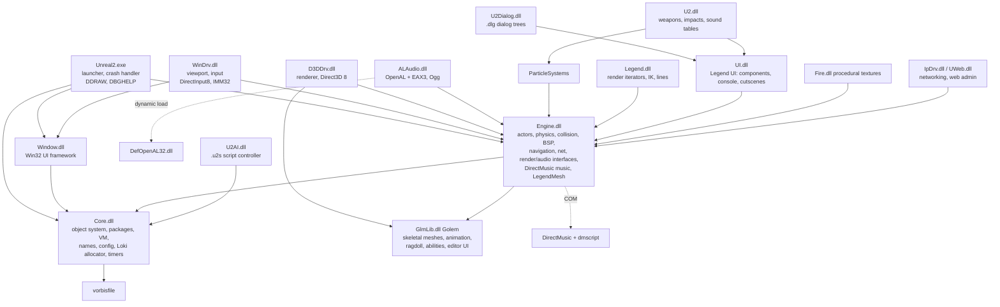

# Engine architecture and dependency map: Unreal II (Legend `U2_829` branch of UE2)

The map comes from the export and import tables, the native registration tables, strings, package contents and runtime logs (see RECONNAISSANCE.md). It does **not** assume stock UE2 behaviour: wherever stock UE2 and the evidence disagree, the evidence is used.

## 1. Module graph

## 2. Subsystems: what exists, the evidence, and how a port can obtain each one

Legend:
- **REUSE** — use the original data or code as-is.
- **RECOVER** — derivable from shipped data with demonstrated fidelity.
- **REPLACE** — swap for a portable implementation of the same interface.
- **REIMPL** — rewrite natively from behavioural evidence.
- **UNKNOWN** — not enough evidence yet.

| # | Subsystem | Where | Size and evidence | Port strategy | Status |
|---|---|---|---|---|---|
| 1 | Package format, linker, names, object loading | Core | 324+210 packages parse with no gaps (E1). Legend serialization deviations are catalogued. | REIMPL. Done in Python and in C++ (`uvm`) for the script subset. | **Proven for the table and field layers.** Content native payloads are mapped but not decoded. |
| 2 | UnrealScript VM: opcodes, casts, frames, states, latent actions | Core | 70 opcodes and 32 casts recovered from machine code (E3). The independent VM is byte-identical on 74 lines across 3 platforms (E5). | REIMPL, with original bytecode REUSEd | **Proven for the Core subset.** States, latent actions, iterators, net and replication are not yet exercised. |
| 3 | Core natives: operators, strings, math | Core | 249 numbered and 48 name-bound. 116 natives and 29 of the 32 casts are implemented in `uvm`. | REIMPL. Mostly mechanical. | Partly done |
| 4 | Gameplay script | `.u` packages | 1,317 classes, 8,245 functions, 971 KB of bytecode, with embedded source | **REUSE** the bytecode as-is | Demonstrated (E5) |
| 5 | Actor framework and Engine natives: spawning, tick, timers, states, collision queries, traces, movement, physics modes, navigation, triggers | Engine | 226 native classes. 349 registered natives (92 numbered, 257 by name). Engine.dll has 2.06 MB of code, 6,132 exports with full signatures, and 77k x87 instructions. | REIMPL. This is the bulk of the work. The exported signatures give each method's exact shape. Selective lifting is possible. | Not started. This is the largest effort. |
| 6 | BSP and Model, static meshes, terrain, zones, portals, light maps | Engine | Model 86.5 MB, StaticMesh 374.5 MB, StaticMeshInstance 54.5 MB, Terrain 26 MB of native payload (E7) | REIMPL the loaders and renderer. Formats are close to UE2's (to verify). | Payloads mapped, not decoded |
| 7 | Physics and collision | Engine. Karma (MathEngine) is statically linked. | Strings show Karma runs: "Beginning Karma for game", `McdBatchIntersect*`, `MdtWorld`. **`physKarma` and `physKarmaRagDoll` are logged "obsolete in U2 829"**, so Karma's role is reduced, perhaps to collision only (UNKNOWN). Core movement is UE2 `physWalking` etc. | REIMPL. Must match UE2 movement feel. Karma's role needs tracing. | UNKNOWN extent |
| 8 | Skeletal animation: **Golem** | GlmLib.dll, `LegendMesh` in Engine, `.gem`, `.ugx`, `.dds`/`.tga` | 2.15 MB of code, 85k x87 instructions, 2,838 exports, 148 classes. 226 `.gem` files share one header structure (E7). Ragdoll is done here. D3DDrv calls Golem materials and shaders directly. | **Selective static recompilation** (lift GlmLib, oracle-tested), or REIMPL after decoding the format. **Golem is also the editor**, so much of GlmLib is unneeded. | UNKNOWN format; the biggest proprietary blocker |
| 9 | Particles | ParticleSystems.dll | 89 native classes, 41 natives, 380 KB of code. Particle templates carry native payloads. | REIMPL, or lift | Not started |
| 10 | Legend render extensions: render iterators (`UCoronaRI`, `UMotionBlurRI`, `UWetWindshieldRI`, ...), `ASunLight`, IK, lines | Legend.dll | 15 native classes, 30 KB of code | REIMPL. Small. | Not started |
| 11 | Renderer | D3DDrv.dll (`UD3DRenderDevice`) | Direct3D 8 (VS 1.1 / PS 1.4 per log), `FRenderInterface`. Fullscreen mode switching **fails on this machine** (D3DERR_DEVICELOST, last log). | REPLACE with a portable renderer (Vulkan, GL/GLES or D3D11). D3D8 semantics can be borrowed from DXVK's D3D8 frontend. | Not started |
| 12 | Viewport, window and input | WinDrv.dll, Window.dll | DirectInput8 plus Win32 messages and IMM | REPLACE with SDL3 | Straightforward |
| 13 | Sound effects | ALAudio.dll | OpenAL 1.0-era API and EAX 3.0. Ogg Vorbis for streamed voice (1,919 files). | REPLACE with OpenAL Soft (supports legacy EAX and runs on Android) | Straightforward |
| 14 | **Adaptive music** | Engine.dll via COM DirectMusic, `.con` | 8 containers: 98 segments, 444 tracks, 97 waves (95 MS-ADPCM), **8 AudioVBScript scripts** | REIMPL a DirectMusic subset (segment and wave-track playback plus the scripted transitions the game uses). Prior art: GothicKit/dmusic (MIT, incomplete) and Wine dmime/dmscript (LGPL). Fallback: pre-rendered stems. | UNKNOWN effort. A notable blocker. |
| 15 | UI: menus, HUD, console, cutscene UI | UI.dll, `.ui` scripts | 3 native object classes, but 81 C++ classes, 592 KB of code, 26 natives | REIMPL. The `.ui` text scripts are reusable. | Not started |
| 16 | Dialog | U2Dialog.dll, `.dlg` | 10 native classes, 21 natives. INI text format. | REIMPL. Small. | Not started |
| 17 | Level and NPC scripting (`.u2s`) | U2AI.dll (`UScriptControllerBase`) | Plain-text command scripts (`ontrigger`, `gotolabel`, `sleep`, ...), 1,028 files | REIMPL an interpreter. Small. | Not started |
| 18 | Procedural textures | Fire.dll (fire, water, ice, wet) | 7 native classes, 46 KB | REIMPL | Not started |
| 19 | Networking and web admin | IpDrv/UWeb | Single player hardly needs these | Defer | — |
| 20 | Save games | Engine (`UGameEngine::SaveGame`, `.usa`) | Packages that snapshot the level (E7) | Follows from 1 + 5. Save compatibility requires the actor serializers. | Parsing proven at table level |
| 21 | Config and localisation | Core (`.ini`, `.int`) | Text | REIMPL. Trivial. | — |
| 22 | Crash handling, `guard`/`unguard` | All modules (23.7k SEH frames) | C++ EH used for error unwinding and logging | Drop in a reimplementation. Must be modelled if recompiling. | — |
| 23 | Editor (UnrealEd, Editor.dll, GlmEd) | Editor only | | Not needed to play | Out of scope |

## 3. Native surface a reimplementation must provide

These counts are measured, not estimated:

- **Script-visible natives:** 723 functions declared `native` in the shipped `.u` files:
  - 277 bound by index and 446 by name.
  - 213 distinct indices are actually called from shipped bytecode.
  - Missing in the shipped DLLs: `ScriptedTexture` 472–476.
- **VM machinery:** 70 opcodes and 32 casts.
- **Native classes:** **410 C++ classes registered with the object system** across the runtime modules:

| Module | Classes |
|---|---:|
| Engine | 226 |
| ParticleSystems | 89 |
| Core | 35 |
| Legend | 15 |
| IpDrv | 10 |
| U2Dialog | 10 |
| Fire | 7 |
| U2 | 6 |
| UI | 3 |
| U2AI | 2 |
| UWeb | 2 |
| WinDrv | 2 |
| ALAudio | 1 |
| D3DDrv | 1 |
| Window | 1 |

  Many of these have native `Serialize`, `Tick`, `PostLoad` or collision behaviour beyond their script natives.
- **Native payload loaders** are needed for **253 content classes**, about 1.6 GB of single-player data (see the content survey).
- **Engine events called from C++ into script** are exported as `event*` wrappers with full signatures: 151 in Engine.dll and 240 across all modules (e.g. `AController::eventAIHearSound`, `AZoneInfo::eventActorEntered`). They define the engine→script call surface precisely.

## 4. Platform dependency surface (what binds the game to Windows/x86)

| Dependency | Users | Portable replacement |
|---|---|---|
| Direct3D 8 (`Direct3DCreate8`) | D3DDrv, GlmLib | Own renderer (Vulkan/GLES/D3D11), or DXVK's D3D8 frontend (zlib) |
| DirectInput 8 | WinDrv | SDL3 |
| DirectMusic (COM) | Engine | Custom subset; GothicKit/dmusic (MIT); Wine's code (LGPL) |
| DirectDraw (`DirectDrawCreate`) | Unreal2.exe (capability probing) | Not needed |
| OpenAL 1.0 + EAX 3.0 | ALAudio | OpenAL Soft (LGPL; supports legacy EAX) |
| Ogg Vorbis | Core, ALAudio | libvorbis (BSD) |
| Winsock | IpDrv | BSD sockets |
| Win32 / GDI / IMM / comdlg / shell | Window, WinDrv, Engine (GDI TrueType font factory, editor-side) | SDL3 plus stb/freetype |
| DbgHelp, SEH, C++ EH | All | Native exceptions or none |
| msvcr70 / msvcp70 | All | Any modern C/C++ runtime |
| x87 floating point | All, 185k instructions | IEEE double/float. Bit-exactness was demonstrated for sampled code (E6), with caveats in BLOCKERS. |

## 5. What is reusable as-is

- All game data:
  - packages (`.u` bytecode, maps, textures, sounds, static meshes);
  - Ogg voice;
  - text scripts (`.u2s`, `.dlg`, `.ui`, `.int`, `.ini`);
  - Golem `.gem` files and their textures (once decoded or loaded via lifted GlmLib);
  - DirectMusic `.con` (once a player exists).
- The **gameplay logic in UnrealScript**. This is the main reason a hybrid approach is attractive: a large share of the game's behaviour lives in 971 KB of bytecode that has already been run bit-exactly on a new VM (E5). Embedded source text exists for every class, for local reference.
