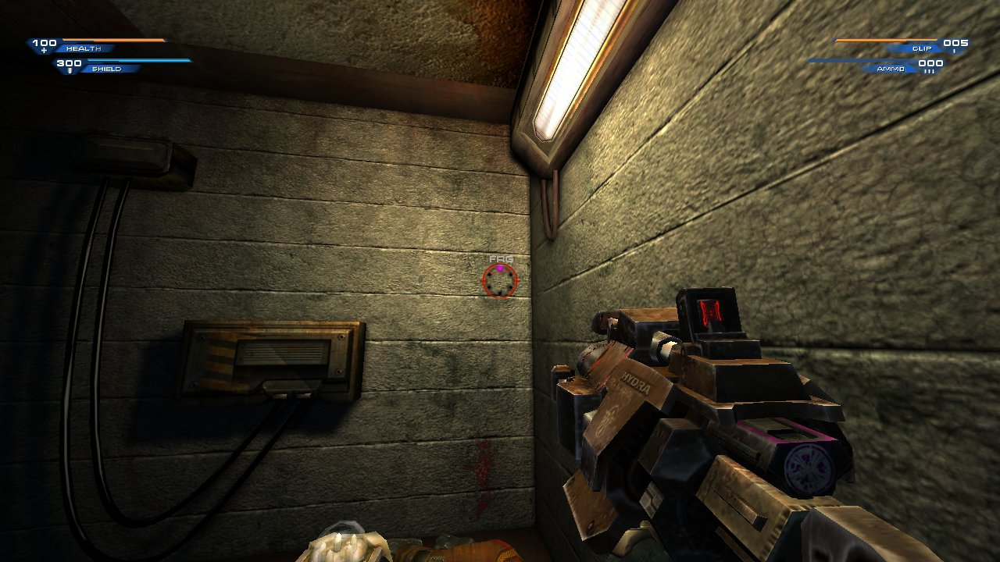
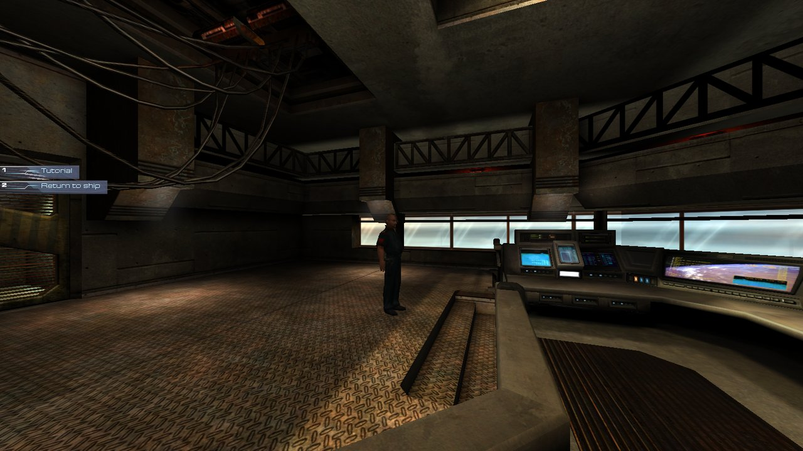
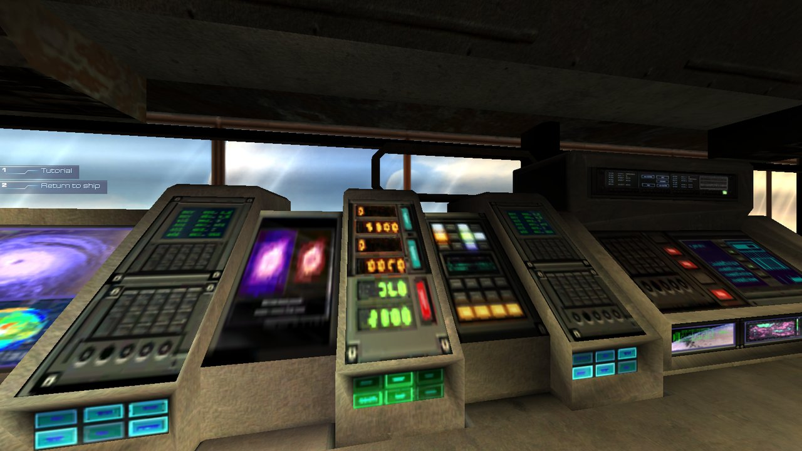
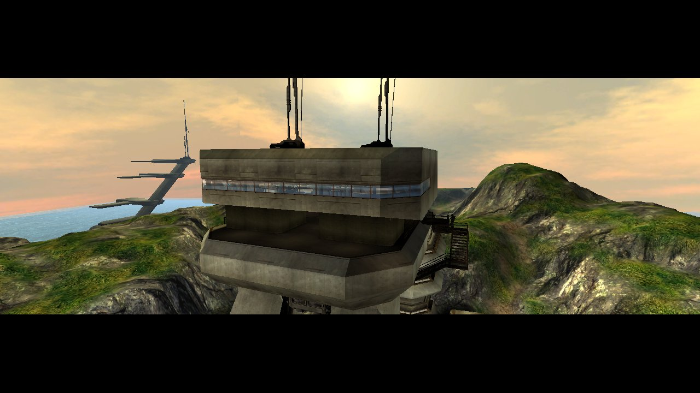

# Unreal II: The Awakening — Native Recompilation Project

A research and engineering project that runs *Unreal II: The Awakening* (Legend Entertainment / Epic Games, 2003) as a
**native 64-bit Windows program**. The game's original 32-bit x86 program code is statically translated into C,
recompiled for x64, and linked against a new runtime that replaces the Windows, Direct3D 8, DirectInput and DirectMusic
services the original binaries expect.

The project ships **no game content and no original code**. Everything here is tooling, runtime, tests and
documentation; a build is produced locally from the user's own installed copy of the game.



*Frame captured from the recompiled x64 player during an automated test launch (M08A1, loaded from a save).*

## Status

**Experimental, single-player, Windows x64.** The recompiled client plays real campaign content, but it is not
finished and has not been tested end to end.

What has been demonstrated with automated, contained launches (journals and reports are in the repository):

- Start-up, intro, attract loop, main menu, **New Game → CS_Titles → TutA** with the opening cutscene, subtitles and
  player control (walk, turn, strafe, look, jump).
- Level transitions **TutB → PD_Avalon → Atlantis** and **Atlantis → PA_Sanctuary → M08A1**; combat in M08A1 with
  enemy kills; M08A1 completed and M08A2 reached in a later batch.
- Saving and loading (F5/F8 and menus), settings persistence, music through Windows' own DirectMusic, sound through
  XAudio2, normal shutdown with no process left behind.
- A 516-second three-level soak with in-map reloads and no fatal error.
- Performance: the game thread reached about **78–103 FPS in TutA** after the first optimisation round and
  **150–180 FPS in M08A1 combat** after round four (measurements in `tools/xrt/dev/PERF_REPORT_*.md`).

What has **not** been demonstrated: a full campaign playthrough, real interactive foreground sessions longer than a
few minutes, multiplayer (XMP), Linux or Android builds of the full game, and audible output checks (tests ran muted
with metered mix levels).

The most recent milestone is a double-clickable standalone player, `Unreal II Enhanced.exe` (2026-11-03,
[report](tools/xrt/dev/PLAYER_REPORT_20261103.md)), validated in 11 of 12 contained launches.

| | |
|---|---|
|  |  |
| TutA training facility (player control, 1600×900 window) | TutA, Hor+ widescreen field of view |
|  | |
| CS_Titles opening cutscene (letterboxed) | |

All screenshots are frames read back from the recompiled client's presented back buffer during test runs on
2026-11-03. They show the original game's art rendered by this project's runtime.

## Downloads

**Experimental:** [`v0.1.0-alpha.1`](https://github.com/thekojac304/unreal2-recompiled/releases/tag/v0.1.0-alpha.1)
(Windows x64).

1. Unzip it and start `Unreal II Enhanced.exe`.
2. It finds your GOG installation, or asks for the folder.
3. On the first start it prepares the game for your computer, which takes a few minutes. Later starts skip this.

No developer tools are needed. The download contains no game files and no translated game code: the bundled
translator (`setup\u2gen.exe`) and LLVM toolchain make that part from your own installation, on your machine
([how it works](tools/xrt/setup/README.md)).

Status of this build:

- **Verified:** first-run preparation without developer tools, caching, and the installation checks.
- **Not yet verified:** rendering and gameplay of this build. The statically linked player built from the same
  sources played TutA through M08A2 in automated tests.

## Enhanced settings

The player adds settings to the game's own Options menus, stored in `User.ini` (`[U2Port.PortSettings]`):

- Video: resolution, borderless full screen (Alt+Enter), frame-rate limit, **field of view with Hor+ widescreen**
  (default 85°), VSync, UI scale. Windows can be resized and maximized.
- Game: walking speed.
- A 60 Hz script-tick ceiling for six actor classes whose scripts misbehave at high frame rates.

## How it works

```
 original game install (read-only)          this repository
 ───────────────────────────────           ─────────────────────────────────────────────
 Core.dll, Engine.dll, GlmLib.dll, ...  ──► tools/xrt/xlift.py   static x86-32 → C translator
 (20 modules, SHA-256 checked)               │  (whole modules: SEH/C++ EH, indirect calls, x87, SSE)
                                             ▼
                                       generated C (local only, never committed)
                                             │  compiled with MSVC / clang-cl for x64
                                             ▼
 experiments/xrt/runtime/   ──────────► one x64 executable, one shared guest address space
   CPU model, guest memory, loader,          │
   HLE: kernel32, user32, msvcr70, ole32,    ├─ D3D8 → DXVK 3.1.1 (Vulkan)
   D3D8/DirectInput COM, GUI, events          ├─ audio → OpenAL 1.0 adapter on XAudio2
                                             └─ DirectMusic → 32-bit helper process (IPC)
```

- **Translation, not emulation.** `xlift.py` lifts entire DLLs to C functions that operate on a modelled x86 CPU state
  in a guest address space. Indirect calls dispatch through per-module function tables with an inline call cache.
  Optimised modes (`--opt`) add register caching, lazy program-counter updates and exception landing pads without
  `setjmp`.
- **High-level emulation (HLE) of the platform.** Windows, CRT and COM imports are implemented by the runtime and
  checked by boundary tests against the native x86 behaviour of the same calls.
- **Differential oracles.** Every stage is checked against the original: instruction-level differential tests
  (`experiments/xrt/tests/insn_diff`, `opt_diff`, `x87`), API boundary fixtures, and the original engine run in a
  sandbox as a reference.
- **Independent components.** An independent package reader (all 324 single-player packages parse with zero
  unaccounted bytes) and an independent C++ UnrealScript VM (byte-identical output to the original on Windows x64,
  Linux x86-64 and Linux ARM64) were built in the feasibility phase as the basis for later replacement of lifted code.

More detail: [ENGINE_ARCHITECTURE.md](ENGINE_ARCHITECTURE.md), [APPROACH_COMPARISON.md](APPROACH_COMPARISON.md),
[feasibility study](docs/FEASIBILITY_STUDY.md), [ROADMAP.md](ROADMAP.md).

## Platforms

| Platform | Status |
|---|---|
| Windows 10/11 x64, Vulkan 1.3 GPU | Working player (experimental) |
| Linux x86-64 | Script VM and lifted code proven bit-exact; full game not attempted |
| Android ARM64 | Script VM and lifted code proven bit-exact under QEMU; full game not attempted |
| Windows ARM64, 32-bit Windows | Not supported |

## Requirements

- *Unreal II: The Awakening* Special Edition (GOG release). The build checks the SHA-256 of every module it
  translates and refuses other versions.
- Windows 10/11 x64, Visual Studio 2026 (MSVC 14.5x, x86 and x64 tools), optionally LLVM `clang-cl`.
- Python 3.14 with `pefile` and `capstone`.
- A GPU and driver with Vulkan 1.3.

## Building from source

The developer loop lives in `tools/xrt/dev` ([README.txt](tools/xrt/dev/README.txt)). Paths to the game installation
and Visual Studio are set at the top of `tools/xrt/dev/dev.py` (`GAME_INSTALL`, `VC`).

```bat
python -I tools/xrt/dev/dev.py setup
python -I tools/xrt/dev/dev.py build --lean --order tools/xrt/dev/order-r4-multi.txt
python -I tools/xrt/dev/dev.py port-build
python -I tools/xrt/dev/dev.py player-build
```

The player is assembled in `out/player/dist/Unreal II Enhanced/` (executable, 32-bit DirectMusic helper, DXVK and its
license, `U2Port.u`, `README.txt`, `build-info.json`). On first start it finds the installation (GOG registry, beside
the executable, or a folder dialog) and keeps its settings and saves in `%LOCALAPPDATA%\UnrealIIEnhanced`. The
installation is only read; its own `Save` folder is never used.

`out/`, `sandbox*/`, generated C and build trees are local only and excluded by `.gitignore`.

## Known limitations

- Experimental; no full campaign run. Scripted tests could not clear the first Izarian pack in M08A1 by open-loop
  input (a test-scripting limit; no translation fault was observed there).
- Subtitle size cannot be changed. Mouse Smoothing (an original game option) over-turns above about 120 FPS.
- Not DPI-aware; one instance at a time; `xrt.log` is capped at 50,000 lines.
- DirectMusic depends on Windows' own DirectMusic; segment script-track events need the project's fallback.
- The strict three-way compatibility qualification (native x86 / native x64 / translated x64) of the Oct 30 init line
  still fails on documented FPU-status and last-error differences; see [CURRENT_STATUS.md](CURRENT_STATUS.md).

## Repository layout

```
tools/xrt/            translator (xlift.py), developer loop (dev/), supervisor, identity and relink tools
tools/pe, pkgreader/  PE reconnaissance; independent package reader and validators
tools/lift/           first function-level lifter (feasibility phase)
experiments/xrt/      runtime sources and ~60 boundary/qualification test suites (90 with the preservation branch)
experiments/uvm/      independent C++17 UnrealScript VM
experiments/lift/     lifting harnesses
docs/                 feasibility study and screenshots
```

Branches: `main` is the current line; `codex/level-initialization` is the development branch it was fast-forwarded
from; `backup/workspace-preservation-2026-11-10` preserves uncommitted experimental-init work from Oct 23–30.

## Legal

- Unreal II: The Awakening is the property of its rights holders (Epic Games). This project is not affiliated with or
  endorsed by Epic Games or Legend Entertainment. The game was delisted from sale in December 2022.
- This repository contains only original tooling, runtime, tests and documentation. It never contains game files,
  extracted UnrealScript, or machine translations of the game's code; `.gitignore` enforces this, and a build needs
  your own installed copy.
- Third-party: DXVK 3.1.1 (zlib/libpng license) is fetched at build time; UELib (MIT) and pip packages are used for
  analysis.
- **No license has been chosen for this repository.** All rights reserved by the author until one is added.
